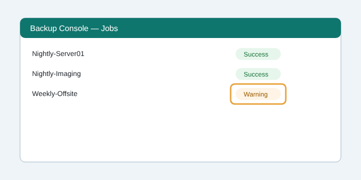

---
site:
  - Main St
  - Riverside
review_cadence: Quarterly
uid: zx60fvs1
type: sop
id: NWD-SOP-IT-004
title: Verify Nightly Backups
department: IT
number: "4"
version: "1.1"
status: Approved
owner: Jordan Lee
owner_role: IT Coordinator
approver: Practice Director
effective: 2026-10-01
classification: Internal Use
---

# Verify Nightly Backups

## 1. WHY — Purpose & Scope

### Purpose

Confirm every morning that last night’s backups finished, so patient records and practice data can always be restored.

### Scope

All servers and the imaging workstation at both clinics. Excludes staff laptops (covered by OPS-SOP-007).

### Why It Matters

An unnoticed failed backup can mean days of lost records after a ransomware attack or disk failure, plus HIPAA reporting exposure.

## 2. WHO — Roles & Responsibilities

### Audience

IT coordinator; office manager as backup.

### Responsibilities

| Role | Name / Team | Responsibility |
| --- | --- | --- |
| IT Coordinator | Jordan Lee | Runs this check every business morning |
| Office Manager | Front desk lead | Covers when the coordinator is out |
| MSP Service Desk | Vendor Partner | Fixes failed jobs within 4 business hours |

## 3. WHAT — Definitions, Inputs & Tools

### Definitions

| Term | Definition |
| --- | --- |
| Job | One scheduled backup of a server or folder |
| Offsite copy | The encrypted copy stored outside the building |

### Prerequisites

- Backup console login
- Access to the IT ticket queue

### Tools & Materials

- Backup console
- IT ticket queue

### Outputs / Deliverables

- Daily checklist entry
- Ticket for any failed or warning job

## 4. HOW — Procedure

### Steps

1. **Open the backup console**
   Sign in with your own account (not a shared login).
2. **Check last night’s jobs**
   Every job should show Success. Anything else needs a ticket.
   
   > ⚠ Caution: A Warning still means some files may be missing.
3. **Open a ticket for any failure**
   Include the job name, status and time. Priority: High.
4. **Record the check**
   Tick today’s row on the IT daily checklist.

### Verification

The checklist shows today’s entry and every failed job has a ticket number.

### Exceptions & Escalation

If two days in a row fail, call the MSP and tell the Practice Director the same day.

## 5. REF — References

- [[NWD-SOP-IT-002 - Offsite Backup Rotation]]
- [Backup Policy.pdf](../../Policies/Backup%20Policy.pdf)

## Revision History

| Version | Date | Author | Change Summary |
| --- | --- | --- | --- |
| 1.0 | 2026-09-15 | Jordan Lee | Approved release |
| 1.1 | 2026-10-01 | Jordan Lee | Added warning handling and photo of the console |
