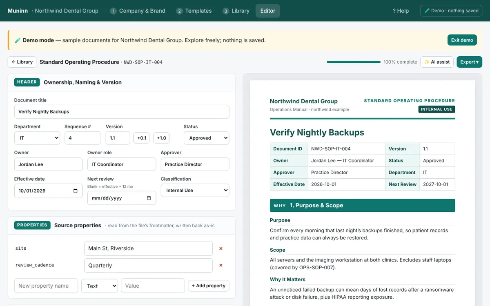
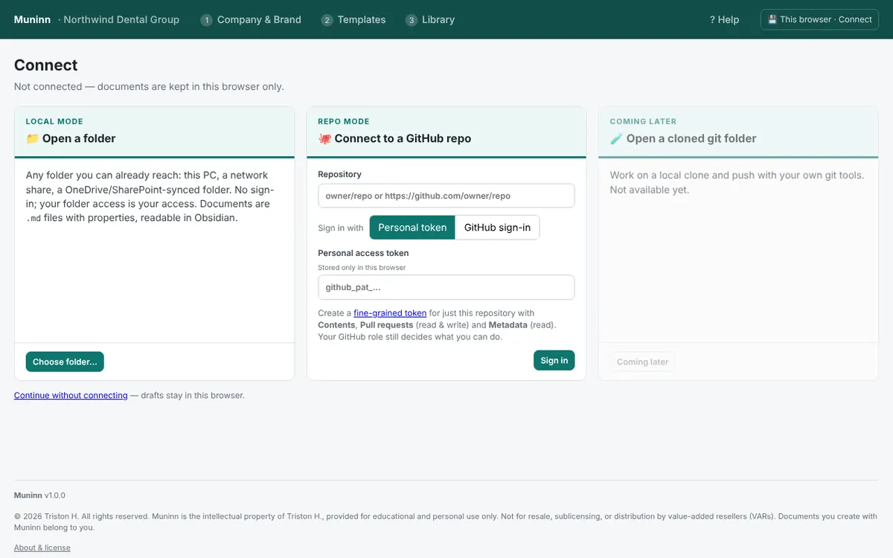
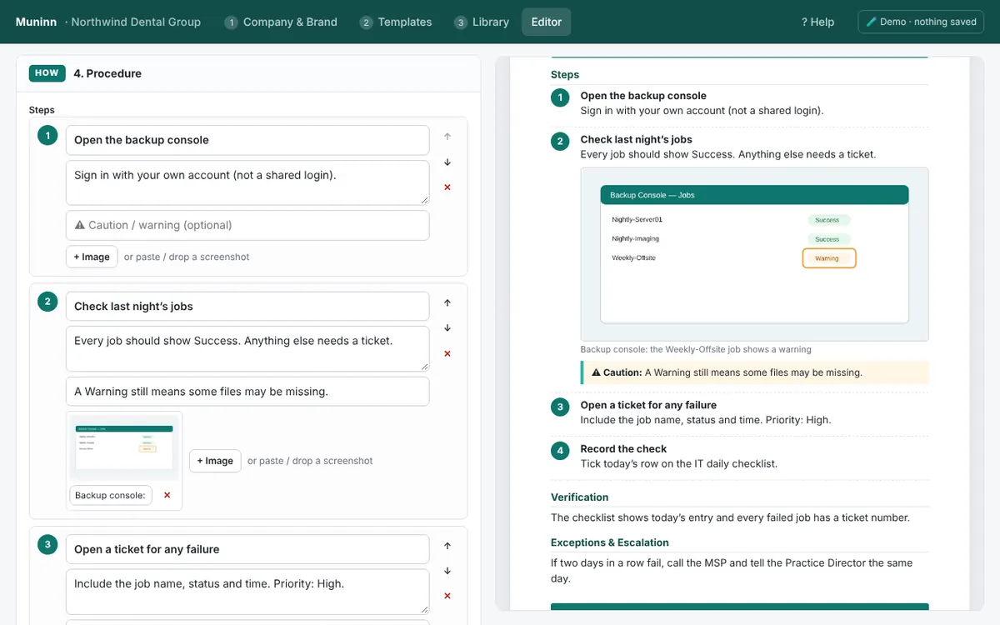
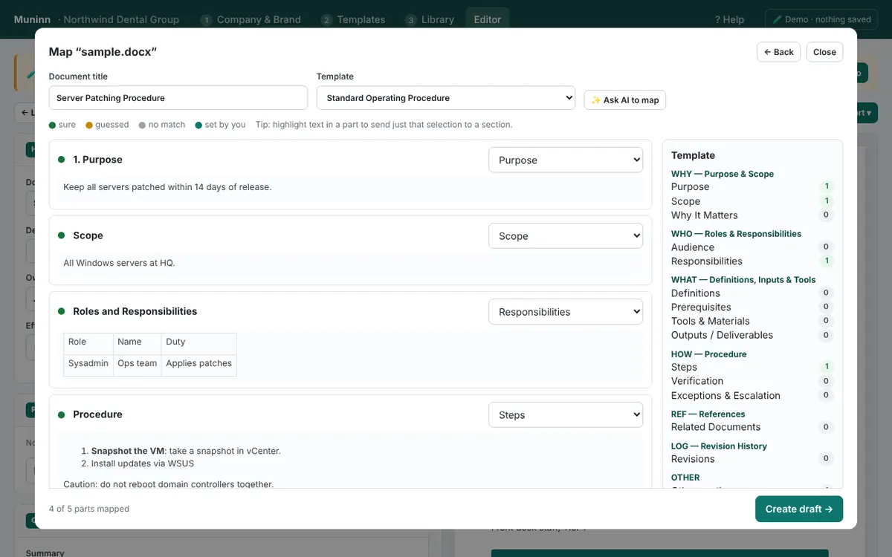
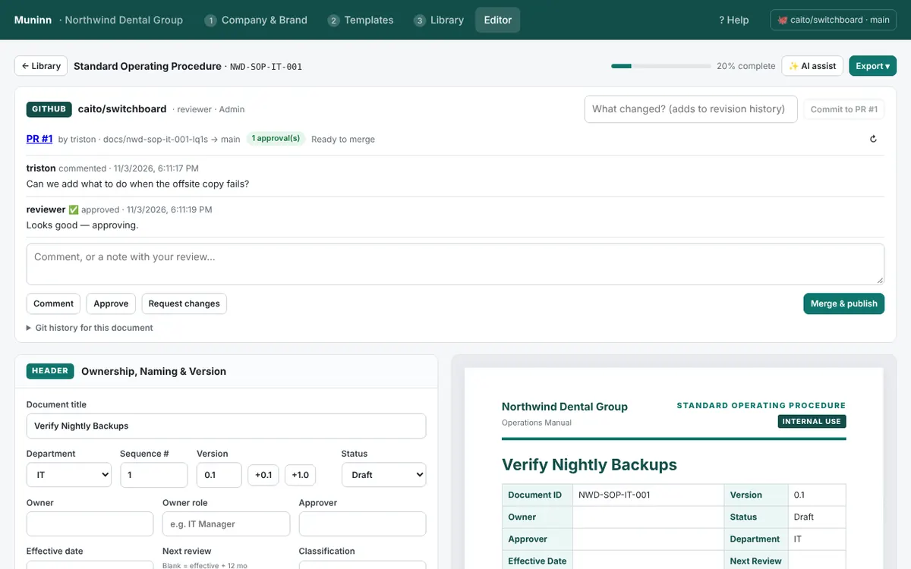

# Muninn — Document Manager

**Write, organise and publish Standard Operating Procedures (SOPs) and Knowledge Base Articles (KBAs) in one consistent, branded format, stored as plain files you own.**

Muninn is a single HTML file. It needs no installation and no server of its own. Open it in a Chromium browser (Chrome, Edge, Brave) and point it at a folder or a GitHub repository.



---

## What it does

- **Guided templates.** SOPs follow **Why → Who → What → How**. KBAs come in two shapes: troubleshooting (symptoms → cause → resolution) and how-to (steps → result).
- **Branding and document control.** Logo, eight colour themes, document IDs, version, owner, approver, review dates, classification, and a revision history on every document.
- **Plain Markdown files.** Every document is a `.md` file with YAML properties, readable in Obsidian, on GitHub, or in any editor. Screenshots are saved as image files next to it.
- **Three storage modes:**

  | Mode | Where documents live | Good for |
  |---|---|---|
  | This browser | Browser storage | Trying Muninn out |
  | **Local mode** | Any folder: PC, network share, OneDrive / SharePoint sync | Small teams, Obsidian users |
  | **Repo mode** | A GitHub repository | Teams that need review and approval |

- **Review and approval through GitHub.** In repo mode every change becomes a pull request. Comments, approvals and merges happen inside Muninn, and GitHub roles and branch rules decide who can do what.
- **Import and migrate.** Bring in Word, Markdown (Obsidian properties are kept), HTML or text documents. Muninn matches each part to a template section, and you review every match before a draft is created.
- **Steps with screenshots.** Paste, drag or upload images into any step.
- **References explorer.** Link other documents and files from this library or other repositories.
- **AI assist, bring your own.** Copy and paste with any chat AI, or connect OpenAI, Anthropic, Gemini, Azure OpenAI, a local model (Ollama, LM Studio) or a webhook (n8n, Power Automate). Nothing is applied without your review.
- **Exports.** Branded Word (.docx), HTML (print to PDF) and Markdown.
- **Built-in help.** A full guide with screenshots and workflow diagrams, plus a demo mode with sample documents.

| | |
|---|---|
|  |  |
|  |  |

---

## Quick start

1. **Download** `Muninn.html` from the latest release (or this repository).
2. **Open it** in Chrome, Edge or Brave.
   - Brave: folder access is off by default. Open `brave://flags/#file-system-access-api`, set it to **Enabled**, and relaunch.
3. **Connect:** choose a folder, a GitHub repo, or *Continue without connecting*.
4. **Brand it:** on **Company & Brand**, add your company name, a logo and a theme.
5. **Write:** on **Templates**, click **New draft**, or **Import a document…**

To look around first, open **? Help → Try the demo**. Sample documents open in a sandbox and nothing is saved.

The `examples/docs` folder has a ready-made sample library you can open in local mode, repo mode or Obsidian. See [`examples/README.md`](examples/README.md).

---

## Setting up repo mode (GitHub)

| Who | What | Guide |
|---|---|---|
| Staff | Sign in with a personal token or your organisation's GitHub sign-in | [docs/SIGN-IN.md](docs/SIGN-IN.md) |
| Admin | GitHub App, sign-in relay, branch rules, preconfigured copy for staff | [docs/ADMIN-SETUP.md](docs/ADMIN-SETUP.md) |
| Admin | Deploy the sign-in relay (Cloudflare Worker, ~15 min) | [relay/README.md](relay/README.md) |

Each organisation sets up its own GitHub App and relay. Nothing depends on the author's accounts or servers.

---

## Repository contents

```
Muninn.html            The app (single file)
index.html             Redirect, so GitHub Pages can serve the app
muninn.json            Version file that copies of Muninn check for updates
relay/                 Optional sign-in relay (Cloudflare Worker) + setup guide
docs/                  Sign-in, admin setup, file format, security, releasing
examples/docs/         Sample document library
LICENSE.md             License terms
CHANGELOG.md           Version history
```

## Requirements

- A Chromium-based browser (Chrome, Edge, Brave). Local mode uses the File System Access API.
- Repo mode: a GitHub account with access to the repository.
- Opening the app inside sandboxed viewers (e.g. embedded previews) limits folder and GitHub access. Open the downloaded file directly.

## Privacy

Muninn has no backend and no analytics. It talks only to what you connect: your folder, GitHub, your organisation's sign-in relay, the AI provider you choose, and, if configured, the public `muninn.json` update file. Details: [docs/SECURITY.md](docs/SECURITY.md).

---

## License

© 2026 Triston H. All rights reserved. Muninn is free for **personal, educational and internal organisational use**. It is **not** for resale, sublicensing, distribution by value-added resellers (VARs), or provision to other organisations as a paid service. Documents you create with Muninn belong to you. See [LICENSE.md](LICENSE.md).
